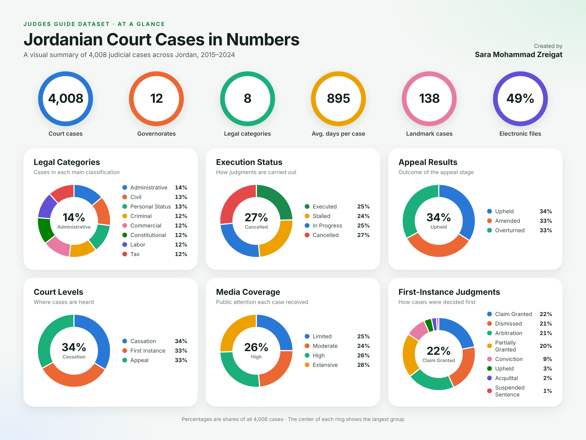

## Dataset at a Glance

  

This infographic provides a visual summary of the Judges Guide dataset, which contains 4,008 Jordanian court cases recorded between 2015 and 2024. It is divided into two parts: a row of key figures at the top, and six ring charts that break the dataset down by its most important dimensions. In each ring chart, the percentages represent shares of all 4,008 cases, and the value at the center highlights the largest group.

### Key Figures

| Indicator | Value | What It Means |
|-----------|-------|---------------|
| Court cases | 4,008 | Total number of judicial cases in the dataset |
| Governorates | 12 | Cases are collected from all twelve governorates of Jordan |
| Legal categories | 8 | Cases are classified into eight main areas of law |
| Average duration | 895 days | A case takes roughly 29 months from filing to judgment |
| Landmark cases | 138 | Cases considered pioneering judgments (3.4% of all cases) |
| Electronic files | 49% | Nearly half of all cases have a digital case file |

### Legal Categories

This chart shows how cases are distributed across the eight main legal classifications. Administrative cases form the largest group at 14%, followed by Civil and Personal Status cases at 13% each. Criminal, Commercial, Constitutional, Labor, and Tax cases each account for about 12%. The close percentages show that no single area of law dominates the dataset, which allows fair comparisons between categories.

### Execution Status

This chart shows the current status of carrying out court judgments. Cancelled judgments represent the largest share at 27%, while executed judgments and those still in progress account for 25% each, and stalled judgments make up 24%. The fact that only about a quarter of judgments have been fully executed indicates that enforcement is a significant challenge in the judicial process.

### Appeal Results

This chart summarizes what happened to cases at the appeal stage. The results are split into almost equal thirds: 34% of decisions were upheld, 33% were amended, and 33% were overturned. This means that around two out of three appealed decisions were changed in some way, which highlights the important role of the appeal courts.

### Court Levels

This chart shows the level of court at which cases are heard. Cases are distributed evenly between the Court of Cassation (34%), the First Instance level (33%), and the Appeal level (33%). This balance ensures that every level of the judicial system is well represented in the analysis.

### Media Coverage

This chart reflects how much public and media attention each case received. High coverage accounts for 26% of cases and extensive coverage for another 26%, while limited and moderate coverage represent 25% and 24% respectively. Overall, media attention is spread fairly evenly, with about half of all cases receiving high or extensive coverage.

### First-Instance Judgments

This chart shows how cases were decided at the first stage of litigation and presents the clearest differences in the dataset. Four outcomes account for about 84% of all decisions: claims granted (22%), dismissals (21%), arbitration (21%), and partially granted claims (20%). Convictions represent 9% of decisions, while upheld decisions (3%), acquittals (2%), and suspended sentences (1%) are relatively rare.

### Key Takeaways

1. **Balanced dataset:** cases are spread evenly across legal categories, court levels, and media coverage levels, which makes the dataset reliable for comparing groups.
2. **Enforcement challenge:** only about one in four judgments has been fully executed, while more than half are stalled or cancelled.
3. **Active appeal process:** about two-thirds of appealed decisions are amended or overturned.
4. **Clear decision patterns:** first-instance judgments are concentrated in four main outcomes, while criminal outcomes such as convictions and acquittals form a smaller share.
5. **Long proceedings:** with an average duration of 895 days, cases typically take more than two years to reach a judgment.
